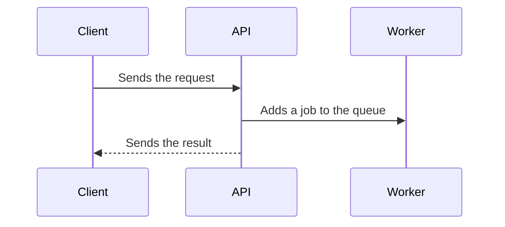

<!--
Title: `type(scope): a verb and the main result`, max 72 characters. Example: `feat(storage): add the Azure Blob service`.
The title becomes the squash commit, so it follows Conventional Commits (`commitlint.config.js`).

Write in ASD-STE100 Simplified Technical English:
- Write one statement in each sentence. Max 20 words in a step, 25 words in other text.
- Use the active voice. Use the present tense for the new behavior, and the past tense only after "Before,".
- Do not use "-ing" words or phrasal verbs: "remove", not "get rid of".
- Use one word for one meaning: "can" = able to, "must" = required. Do not use "may", "should", "ensure", or "via".
- Do not put more than 3 nouns in a row. Keep "the" and "a".
- Put code names, file paths, env variables and endpoints in backticks.

Sections 1–5 are required. Write "None." when a section has nothing.
Optional: add "Status values" (a table) after Rules when the PR adds a status, an env variable or a setting.
Optional: add "Diagram" at the end only when section 3 cannot show the change as one straight list of steps:
- Messages between 3 or more parts in a fixed order (API, queue, worker, provider): use `sequenceDiagram`.
- New status values and the moves between them: use `stateDiagram-v2`.
- 3 or more decisions that branch the flow: use `flowchart TD`.
Do not add a diagram for a refactor or for a flow that section 3 already shows.
-->

**Type:** Feature · Fix · Refactor · Chore · **Area:** <modules, lib, plugins, database, ci> · **Ticket:** [KEY-1](https://lumitech.atlassian.net/browse/KEY-1) · **Side:** [KEY-2](https://lumitech.atlassian.net/browse/KEY-2)

**Risk:** low · medium · high · critical — <the highest dimension and the reason, max 12 words>

<!-- Type: the main change only. Area: the changed parts, for example `modules/message`, `lib/azureBlob`, `plugins`.
     Ticket: write "(part)" when this PR does not close the ticket. Side: delete when there are no side changes.
     Risk: keep one level. Find it with `.github/PR_RISK_LEVELS.md`. Example: "high — data: drops the `status` column in `message`".
     Add the label `risk: <level>` to the PR. For `high` and `critical`, put the rollback plan in section 5. -->

## 1. Purpose

<!-- Paragraph 1: what the PR does for the client or the system. Max 2 sentences.
     Paragraph 2: "Before," and the problem. Max 2 sentences.
     Main change only. Refactor: start with "No behavior change." -->

## 2. Changed parts

<!-- One row for each part, max 8 rows. Part: a plain name and the code name. Change: short sentences that start with a verb.
     Start a side change with "**Side (KEY-2).**" or "**Side (no ticket).**". -->

| Part | Change |
| ---- | ------ |
|      |        |

## 3. Process

<!-- The new behavior, step by step, max 10 steps. Start each step with the actor: "The client", "The API", "The worker", "The cron".
     A reviewer uses these steps as the manual test. Give the endpoint, the command or the env variable for each step.
     Refactor or chore: write "No behavior change." -->

## 4. Rules

<!-- What the code makes true, and the decisions that a reviewer can question. Max 6 bullets.
     Start each bullet with one short sentence in bold. Then give the reason or the limit.
     Name each exception to a rule in `CLAUDE.md` here, with the reason. -->

## 5. Open items

<!-- Ticket items that this PR does not do, risks, and questions that need a sign-off.
     A new env variable, migration or dependency: say what the deploy must do first.
     Risk `high` or `critical`: add "Rollback:" and the steps to undo the change. Say which effects a revert cannot undo
     (an applied migration, sent emails, jobs in the queue, deleted files). -->

<!-- Diagram (optional). Use it only when the test in the top comment says so. To use it, delete this line and the "end of diagram" line.
     Max 12 boxes or arrows. Use the part names from section 2. Write the labels in STE.

## Diagram



end of diagram -->
```
